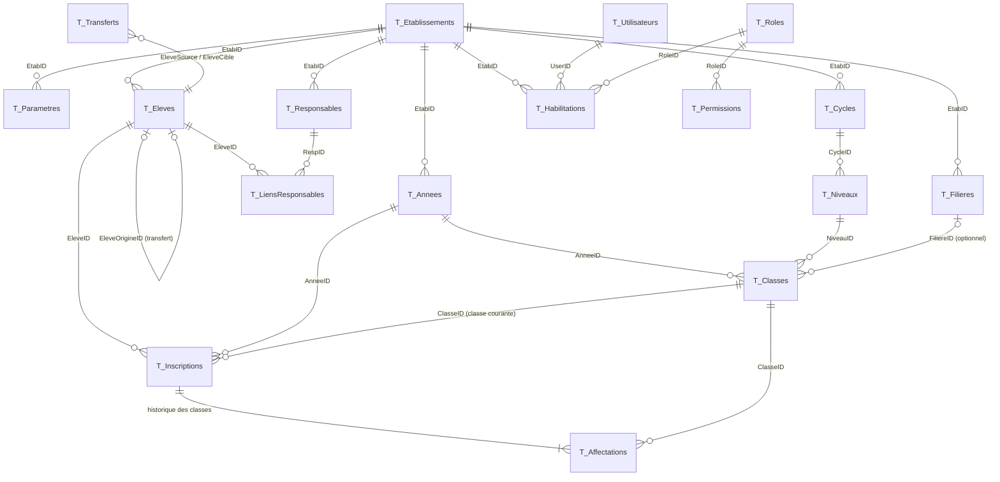

# 02 — Modèle de données

Source de vérité : `src/vba/modSchema.bas` (le tableau ci-dessous en est extrait automatiquement).
Version du schéma : **1**.

## 1. Conventions

- **Une table = une feuille** `T_*` (masquée en production), ligne 1 = noms de colonnes.
- **1re colonne = identifiant technique permanent** `PREFIXE-INST-NNNNNN`
  (`INST` = 4 premiers caractères de l'identifiant d'installation). Jamais modifié, jamais réutilisé.
- Les **codes métier** (matricule, code de classe, code d'établissement) sont distincts des identifiants
  et peuvent suivre un format paramétrable.
- **Cloisonnement** : les tables marquées « oui » portent `EtabID` ; toute lecture métier les filtre.
- **Dates** : texte ISO `AAAA-MM-JJ`, horodatages `AAAA-MM-JJ hh:mm:ss`. Tri et comparaison
  directs, aucune ambiguïté de format régional.
- **Booléens** : `1` / `0`.
- **Aucune suppression physique.** Les fins de validité passent par `Statut`, `Actif`, `DateFin`.
- **Évolution** : ajout de colonnes en fin de table uniquement (`SG_MigrerSchema`), journalisé.

## 2. Tables

| Table | Identifiant | Préfixe | Cloisonnée | Colonnes |
|---|---|---|---|---|
| `T_Systeme` | `Cle` | — | non | Valeur |
| `T_Etablissements` | `EtabID` | ETB | non | Code, Nom, TypeEtab, Statut, Pays, Ville, Adresse, Telephone, Email, Devise, Langue, Actif, DateCreation, CreePar |
| `T_Parametres` | `ParamID` | PRM | oui | EtabID, Cle, Valeur, ModifieLe, ModifiePar |
| `T_Compteurs` | `CompteurID` | CPT | oui | EtabID, Cle, Valeur |
| `T_Roles` | `RoleID` | ROL | non | Code, Libelle, Systeme |
| `T_Permissions` | `PermID` | PER | non | RoleID, Module, Niveau |
| `T_Utilisateurs` | `UserID` | USR | non | Login, NomComplet, Sel, HashMdp, Iterations, Actif, AdminTech, AdminCentral, Echecs, VerrouJusqua, DoitChangerMdp, DateCreation, DernierAcces |
| `T_Habilitations` | `HabID` | HAB | oui | UserID, EtabID, RoleID, DateDebut, DateFin, Actif |
| `T_Annees` | `AnneeID` | ANS | oui | EtabID, Code, Libelle, DateDebut, DateFin, Statut, OuverteLe, ClotureeLe, ClotureePar |
| `T_Cycles` | `CycleID` | CYC | oui | EtabID, Code, Libelle, ModeEvaluation, Ordre, Actif |
| `T_Niveaux` | `NiveauID` | NIV | oui | EtabID, CycleID, Code, Libelle, Ordre, Actif |
| `T_Filieres` | `FiliereID` | FIL | oui | EtabID, Code, Libelle, TypeFiliere, Actif |
| `T_Classes` | `ClasseID` | CLS | oui | EtabID, AnneeID, NiveauID, FiliereID, Code, Libelle, Capacite, Salle, Actif |
| `T_Eleves` | `EleveID` | ELV | oui | EtabID, Matricule, Nom, Prenoms, Sexe, DateNaissance, LieuNaissance, Nationalite, Adresse, Telephone, EtabPrecedent, EleveOrigineID, Statut, DateStatut, CleDoublon, DateCreation, CreePar, ModifieLe, Version |
| `T_Responsables` | `RespID` | RSP | oui | EtabID, Nom, Prenoms, Telephone, Email, Adresse, Profession, Actif |
| `T_LiensResponsables` | `LienID` | LNK | oui | EtabID, EleveID, RespID, Lien, Legal, Financier, Urgence, AutoriseRecuperer, Actif |
| `T_Inscriptions` | `InscriptionID` | INS | oui | EtabID, AnneeID, EleveID, ClasseID, TypeInscription, Decision, DateInscription, DateEffet, Statut, DateFin, MotifFin, CreePar, DateOperation |
| `T_Affectations` | `AffectationID` | AFF | oui | EtabID, InscriptionID, ClasseID, DateDebut, DateFin, Motif, DateOperation, Utilisateur |
| `T_Transferts` | `TransfertID` | TRF | non | EtabSource, EleveSource, EtabCible, EleveCible, DateTransfert, Motif, Utilisateur |
| `T_Sauvegardes` | `SauvID` | SAV | oui | EtabID, Horodatage, Chemin, TypeSauv, NbEvenementsAudit, HashAudit, Statut, Utilisateur |
| `T_Revocations` | `LicenceID` | — | non | ImporteeLe, ListeEmiseLe |
| `T_Audit` | `EventID` | EVT | non | Horodatage, UserID, EtabID, Module, Operation, TableCible, EnregistrementID, Champ, AncienneValeur, NouvelleValeur, Motif, Resultat, TxRef, HashPrec, Hash |

## 3. Relations

`T_Audit.EnregistrementID` référence l'identifiant de n'importe quelle table (`TableCible`).

## 4. Règles d'intégrité appliquées par le code

| Règle | Où |
|---|---|
| Une seule inscription `ACTIVE` par élève, année et établissement | `Inscr_Inscrire` |
| Une seule affectation ouverte (`DateFin` vide) par inscription ; l'ancienne est close la veille de la date d'effet | `Inscr_ChangerClasse` |
| La classe d'une inscription appartient à la même année et au même établissement | `ControlerClasse`, contrôle qualité |
| Une seule année `OUVERTE` par établissement ; dates sans chevauchement | `modAnnee` |
| Aucune écriture dans une année `CLOTUREE` | `Annee_ExigerModifiable` |
| L'ordre des niveaux est unique (il détermine passage / redoublement) | `Niveau_Creer` |
| Matricule unique dans l'établissement | `Eleve_Creer`, contrôle qualité |
| Clé de doublon = nom + prénoms normalisés (sans accents, tirets) + date de naissance | `Eleve_CleDoublon` |
| Effectif ≤ capacité (paramètre `CAPACITE_STRICTE`) | `ControlerClasse` |

## 5. Cycles de vie

**Année** : `PREPARATION` → `OUVERTE` → `CLOTUREE` → (`OUVERTE` par réouverture motivée).

**Inscription** : `ACTIVE` → `TERMINEE` (départ, transfert sortant, radiation, fin de cycle) ou `ANNULEE`.
Types : `PREMIERE`, `REINSCRIPTION` (décision déduite : `PASSAGE`, `REDOUBLEMENT`, `SAUT_DE_CLASSE`,
`ORIENTATION`), `TRANSFERT_ENTRANT`.

**Élève** : `NOUVEAU` → `ACTIF` ⇄ `SUSPENDU` ; → `PARTI` / `TRANSFERE` / `RADIE` / `DIPLOME` ;
réintégration possible (`PARTI`/`RADIE` → `NOUVEAU`, `SUSPENDU` → `ACTIF`).

## 6. Paramètres par établissement (`T_Parametres`)

| Clé | Défaut | Rôle |
|---|---|---|
| `FORMAT_MATRICULE` | `{ETAB}-{AAAA}-{N5}` | Numérotation des matricules |
| `FORMAT_CERTIFICAT` | `CS-{ETAB}-{AAAA}-{N5}` | Numérotation des certificats (valeur par défaut si absent) |
| `NOTE_MAX` | `20` | Réservé au module Notes |
| `CAPACITE_STRICTE` | `1` | Refus au-delà de la capacité |
| `AGE_MIN_INSCRIPTION` | `2` | Contrôle de la date de naissance |
| `MOTIF_OBLIGATOIRE_CHAMPS` | `Nom;Prenoms;DateNaissance;Sexe` | Champs dont la modification exige un motif |

## 7. Tables prévues (phases suivantes)

`T_Matieres`, `T_Coefficients`, `T_Periodes`, `T_Evaluations`, `T_Notes` (avec statut
`ABSENT`/`DISPENSE`/`NON_RENDU` distinct de zéro), `T_Competences`, `T_Bulletins`, `T_Deliberations`,
`T_Presences`, `T_Tarifs`, `T_Factures`, `T_LignesFacture`, `T_Paiements`, `T_AffectationsPaiement`,
`T_Recus`, `T_Depenses`, `T_Caisse`, `T_Personnels`, `T_Contrats`, `T_EmploisDuTemps`, `T_Salles`,
`T_Articles`, `T_MouvementsStock`, `T_Biens`. Elles suivront les mêmes conventions.
