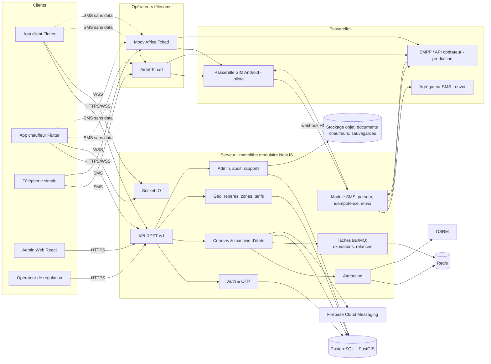

# 3. Architecture technique

## 3.1 Choix technologiques et justification

| Besoin | Choix recommandé | Alternatives écartées | Justification (coût, sécurité, maintenance, marché local) |
|---|---|---|---|
| Applications mobiles | **Flutter** (une base de code, deux applications : client et chauffeur, via *flavors*) | Natif Kotlin (2× effort si iOS un jour), React Native | Android dominant au Tchad ; Flutter produit des applications performantes sur téléphones modestes ; une seule compétence à recruter ; iOS possible plus tard sans réécriture. Viser APK < 20 Mo, Android 8+ |
| Backend | **Node.js + NestJS** en **monolithe modulaire** | Microservices ; Django | NestJS impose une structure (modules, injection, validation) facile à maintenir par une petite équipe. Microservices = complexité et coûts injustifiés au démarrage ; les modules sont découpés pour pouvoir être extraits plus tard |
| Base de données | **PostgreSQL 16 + PostGIS** | MongoDB, MySQL | Transactions fiables (indispensables contre la double attribution), requêtes géographiques (`ST_DWithin`, index GiST), gratuit, très bien documenté |
| Cache, positions temps réel, files | **Redis** (+ **BullMQ** pour les tâches) | Kafka, RabbitMQ | Positions des chauffeurs en mémoire (GEO), expirations d'offres, limitation de débit, adaptateur WebSocket multi-instance. Un seul composant simple pour plusieurs besoins |
| Temps réel | **Socket.IO** (WebSocket avec reconnexion automatique) | WebSocket brut, MQTT | Reconnexion et reprise gérées, bibliothèques Flutter disponibles. MQTT est plus économe et reste une option si la consommation data pose problème en test terrain |
| Notifications | **Firebase Cloud Messaging** (gratuit) | OneSignal | Réveille l'application chauffeur en arrière-plan. **Nécessite la data** : en son absence, bascule SMS |
| Cartes | **OpenStreetMap** : tuiles vectorielles de la ville **embarquées hors ligne** (MBTiles, quelques dizaines de Mo au plus pour Abéché) via `flutter_map` / MapLibre | Google Maps | Google Maps : coût par chargement, couverture d'Abéché incertaine, pas de vrai hors-ligne. OSM : gratuit, modifiable par nous (on peut ajouter rues et repères), hors ligne |
| Itinéraires / temps d'arrivée | **OSRM** auto-hébergé sur l'extrait OSM du Tchad | Google Directions | Gratuit, rapide, petit serveur suffisant. Fiabilité dépendant de la qualité OSM : en V1, le classement utilise la distance, l'ETA n'est utilisé qu'une fois validé terrain |
| Géocodage | **Base de repères locale** (table `landmarks` + recherche floue `pg_trgm`) + Nominatim en secours | Google Places | Les repères d'Abéché ne sont dans aucune base commerciale ; il faut les collecter |
| Tableau de bord admin | **React (Vite) + Refine** ou React-Admin, même API | Back-office séparé en PHP | Écrans CRUD rapides à produire, même langage (TypeScript) que le backend |
| SMS | Interface `SmsProvider` avec adaptateurs : passerelle SIM (pilote), agrégateur HTTP, SMPP opérateur | Dépendance directe à un fournisseur | Permet de changer de passerelle sans toucher à la logique métier |
| Hébergement | **VPS / cloud européen** (OVH, Scaleway ou Hetzner), Docker Compose au départ | AWS/GCP managé ; hébergement au Tchad | Aucun cloud public majeur n'a de région au Tchad ; l'Europe offre une latence acceptable (≈ 100–200 ms, à mesurer) et des prix bas. **À valider juridiquement** : transfert de données hors du Tchad (loi 007/PR/2015, voir doc 07) |
| Sauvegardes | `pg_dump` + WAL (pgBackRest) vers stockage objet d'une **autre** région, chiffrées | — | Restauration testée mensuellement |
| Supervision | Sentry (erreurs), Uptime Kuma (disponibilité), Prometheus + Grafana (métriques), alertes SMS/WhatsApp à l'équipe | Datadog (coût) | Outils gratuits ou peu chers |
| Secrets | Variables chiffrées (Doppler / SOPS + age) ; jamais dans le dépôt Git | Fichier `.env` versionné | — |

## 3.2 Diagramme d'architecture



## 3.3 Composants

| Module | Responsabilités |
|---|---|
| `auth` | Inscription/connexion par téléphone, OTP (SMS), JWT courte durée (15 min) + jeton de rafraîchissement rotatif, rôles (client, chauffeur, opérateur, admin, super-admin) |
| `users` / `drivers` | Profils, véhicules, documents (photos stockées chiffrées), statut de vérification, disponibilité |
| `geo` | Repères, quartiers, zones desservies (polygones), grille tarifaire zone→zone, recherche floue |
| `rides` | Machine d'états de la course, annulations, avis, incidents, historique |
| `matching` | Recherche des candidats, classement, vagues d'offres, attribution atomique |
| `sms` | Réception (webhooks), normalisation, parseur, idempotence, envoi, journal et coût |
| `realtime` | Socket.IO : offres aux chauffeurs, statut au client, positions |
| `admin` | API du tableau de bord, journaux d'audit, exports CSV/Excel, statistiques |
| `jobs` | Expiration des offres, nouvelles tentatives, clôture automatique, purge des données selon la politique de conservation |

## 3.4 Flux de données principaux

### Demande par application (mode A)

1. Client → `POST /v1/rides` (`Idempotency-Key`, type, départ, destination).
2. Serveur valide (zone desservie, limites, client non bloqué) → course `SEARCHING`.
3. `matching` récupère les candidats → envoie les offres (Socket.IO + FCM ; SMS si le
   chauffeur est en mode SMS) → course `OFFERED`.
4. Chauffeur → `POST /v1/offers/{id}/accept` → attribution atomique → course `ASSIGNED`.
5. Client notifié (Socket.IO/FCM, SMS de secours s'il n'accuse pas réception sous 30 s).
6. Chauffeur : `ARRIVED` → `IN_PROGRESS` → `COMPLETED` ; position envoyée toutes les
   5–15 s pendant la course active, 30–60 s en attente, rien hors service.
7. Avis réciproques.

### Demande par SMS (mode B)

Voir doc 02 §2.4. Les SMS entrants passent par : webhook → vérification de signature →
normalisation → idempotence → parseur → mêmes services `rides` / `matching` que l'application.
**Il n'existe qu'une seule logique métier** quel que soit le canal.

## 3.5 Machine d'états d'une course

```
SEARCHING ──offre envoyée──> OFFERED ──acceptée──> ASSIGNED ──> ARRIVED ──> IN_PROGRESS ──> COMPLETED
    │                          │  └─refus/expiration─> SEARCHING (vague suivante)
    │                          │
    └─aucun chauffeur (délai)──┴──> NO_DRIVER
Annulation possible : SEARCHING/OFFERED/ASSIGNED/ARRIVED ──> CANCELLED_BY_CLIENT | CANCELLED_BY_DRIVER | CANCELLED_BY_OPS
```

Chaque transition est enregistrée dans `ride_events` (horodatage, acteur, canal).

## 3.6 Modèle de données (ébauche)

```
users(id, phone_e164 UNIQUE, phone_verified_at, name, role, lang, status, created_at)
drivers(user_id PK→users, transport_type[taxi|rakcha|clando], verification_status,
        rating_avg, rating_count, acceptance_rate, channel_pref[app|sms], suspended_until)
vehicles(id, driver_id, type, plate, color, brand, seats, verified_at)
driver_documents(id, driver_id, kind[permis|carte_grise|assurance|cni|autorisation],
        file_key, expires_on, status, reviewed_by, reviewed_at)
driver_presence(driver_id PK, available BOOL, location geography(Point,4326),
        location_source[gps|landmark], location_at, battery_pct, app_version)
landmarks(id, name, aliases TEXT[], name_ar, kind, quartier, location geography(Point),
        zone_id, verified BOOL)          -- index GIN pg_trgm sur name/aliases
zones(id, name, area geography(Polygon), active BOOL)
tariffs(id, transport_type, from_zone_id, to_zone_id, price_min, price_max, valid_from)
rides(id, public_code UNIQUE, client_id, driver_id NULL, transport_type, status,
      pickup geography(Point), pickup_landmark_id, pickup_text, dropoff_landmark_id,
      dropoff_text, price_quoted, channel[app|sms|ops], idempotency_key,
      pickup_pin, created_at, assigned_at, completed_at, version INT)
ride_offers(id, ride_id, driver_id, wave, channel, code, sent_at, expires_at,
      response[accepted|declined|expired|late], responded_at)
ride_events(id, ride_id, from_status, to_status, actor_id, channel, at, meta JSONB)
ratings(id, ride_id, from_user, to_user, stars, comment)
incidents(id, ride_id, reporter_id, category, description, status, assigned_to)
sms_messages(id, direction, provider, msisdn_hash, msisdn_enc, body, parsed JSONB,
      ride_id, cost_xaf, status, received_at)   -- numéro chiffré + empreinte pour recherche
admin_audit_logs(id, admin_id, action, entity, entity_id, at, ip, diff JSONB)
roles / permissions / admin_role_assignments
```

Contraintes clés :

- Index unique partiel : un chauffeur ne peut avoir **qu'une course active**
  (`UNIQUE (driver_id) WHERE status IN ('ASSIGNED','ARRIVED','IN_PROGRESS')`).
- Index unique partiel : un client ne peut avoir qu'une demande en recherche à la fois
  (configurable).
- `rides.idempotency_key` unique par client.

## 3.7 API (ébauche, `/v1`)

| Méthode | Route | Rôle |
|---|---|---|
| POST | `/auth/otp/request`, `/auth/otp/verify`, `/auth/refresh` | public |
| GET/PATCH | `/me` | tous |
| GET | `/landmarks/search?q=` | client, chauffeur, ops |
| GET | `/tariffs/quote?type=&from=&to=` | client |
| GET | `/drivers/nearby?type=&lat=&lng=` (positions arrondies, pas d'identité) | client |
| POST | `/rides` · GET `/rides/{id}` · POST `/rides/{id}/cancel` · POST `/rides/{id}/rating` · POST `/rides/{id}/incident` | client |
| PUT | `/driver/availability` · POST `/driver/location` (lots de positions) | chauffeur |
| POST | `/offers/{id}/accept` · `/offers/{id}/decline` | chauffeur |
| POST | `/rides/{id}/arrived` · `/start` (avec code client) · `/complete` | chauffeur |
| POST | `/sms/inbound/{provider}` (signé HMAC) · `/sms/status/{provider}` | passerelle |
| — | `/admin/*` (utilisateurs, documents, zones, tarifs, courses, incidents, SMS, stats, exports) | admin selon permissions |

Événements Socket.IO : `offer.new`, `offer.revoked`, `ride.updated`, `driver.location`
(uniquement vers le client de la course en cours).

## 3.8 Algorithme d'attribution

Paramètres configurables par l'admin (valeurs initiales indicatives) : rayon initial 1,5 km,
paliers 3 km puis 5 km ; taille de vague app = 3 chauffeurs ; vague SMS = 1 chauffeur ;
délai de réponse app = 20 s, SMS = 90 s ; délai total de recherche = 5 min (app) / 8 min (SMS).

```text
fonction traiterDemande(demande):
  valider(demande)                       # zone desservie, client non bloqué, limites, idempotence
  course = créer(status=SEARCHING)
  exclus = {}
  pour rayon dans [1.5, 3, 5] km:
    tant que temps_écoulé < délai_total:
      candidats = chauffeurs où
          type = demande.type
          ET disponible ET vérifié ET non suspendu
          ET aucune course active
          ET position récente (app: < 2 min ; SMS: repère < 30 min)
          ET distance(position, départ) <= rayon
          ET id ∉ exclus
      si candidats vide: passer au rayon suivant
      score(c) = 0.6 * distance_norm        # ou ETA OSRM une fois validé terrain
               + 0.2 * (1 - taux_acceptation)
               + 0.1 * (1 - temps_inactivité_norm)   # équité : favorise ceux qui attendent
               + 0.1 * fraîcheur_position_norm
      vague = meilleurs(candidats, taille selon canal du chauffeur)
      envoyer offres(vague, expires_at)  → course OFFERED
      attendre première acceptation OU expiration de toutes les offres
      si acceptée: retourner
      exclus += vague ; course → SEARCHING
  course → NO_DRIVER ; informer le client (app/SMS) ; proposer réessai ou opérateur
```

**Attribution atomique (cœur anti-double réservation)** — dans une transaction :

```sql
UPDATE rides
   SET driver_id = :driver, status = 'ASSIGNED', assigned_at = now(), version = version + 1
 WHERE id = :ride AND status = 'OFFERED'
   AND EXISTS (SELECT 1 FROM ride_offers
                WHERE id = :offer AND ride_id = :ride AND driver_id = :driver
                  AND response IS NULL AND expires_at > now())
RETURNING id;
```

- 1 ligne retournée → ce chauffeur a gagné ; les autres offres de la vague sont révoquées
  (`offer.revoked`).
- 0 ligne → `409 déjà attribuée / expirée`, le chauffeur est informé.
- L'index unique « une course active par chauffeur » empêche aussi un chauffeur d'accepter
  deux courses en même temps (deux appareils, deux SMS).

### Cas dégradés

| Situation | Comportement |
|---|---|
| Aucun chauffeur disponible | Élargissement du rayon, puis `NO_DRIVER` : message au client avec option « réessayer » ; alerte opérateur pendant le pilote ; statistique de demande non servie par zone/heure (pour recruter) |
| Le chauffeur perd le réseau après avoir accepté | La course reste `ASSIGNED` ; le client a le numéro et peut appeler ; si aucun signe du chauffeur pendant N minutes et sur signalement client → l'opérateur peut réattribuer |
| Le client perd le réseau | Le chauffeur a son numéro ; la confirmation SMS de secours part si l'app client n'accuse pas réception |
| Panne du serveur ou de la liaison internationale | Les apps affichent le mode dégradé et proposent l'appel direct à l'opérateur ; les SMS reçus par la passerelle SIM sont mis en file sur le téléphone passerelle et rejoués à la reprise ; les demandes plus vieilles qu'un seuil (ex. 15 min) reçoivent « Demande expirée, renvoyez si besoin » plutôt que d'être servies tardivement |
| SMS d'acceptation en retard | Offre expirée → réponse `late`, message « déjà attribuée/expirée », aucune modification |
| SMS de demande en double | Idempotence (doc 02 §2.6) |
| Batterie faible chauffeur (< 15 %) | Envoi de position espacé, avertissement ; le chauffeur est retiré des candidats sous 5 % |
